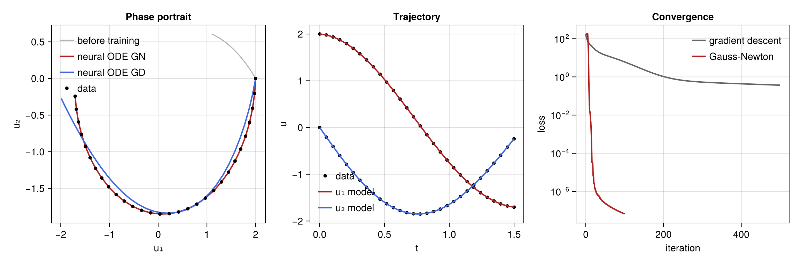

# Neural ODE — the assembly

The last half-hour of the exercise: the four packages, put together.

```julia
cd neural_ode
julia --project=.
] instantiate
include("train_neural_ode.jl")
```

Runs in about two seconds.



## The problem

Data comes from a damped rotation that the network is never told about:

```math
du/dt = A u, \qquad A = \begin{pmatrix} -0.1 & 2 \\ -2 & -0.1 \end{pmatrix},
\qquad u(0) = (2, 0).
```

Thirty points of one trajectory on $t \in [0, 1.5]$. We then replace the
right-hand side by a neural network,

```math
du/dt = NN_\theta(u),
```

and fit its 42 weights so that the integrated trajectory matches the data.

## Who does what

```text
                        θ  (42 numbers)
                        │
       rebuild ─────────┤  FrejusJuliaNeuralNetworks0
                        ↓
                    NN_θ(u)
                        │
       solve_ode ───────┤  FrejusJuliaODE0
                        ↓
              predicted trajectory
                        │
                        ↓
            residuals(θ) = pred − data
                        │
       jacobian ────────┤  FrejusJuliaAD0
                        ↓
                      J(θ)
                        │
       gauss_newton ────┤  FrejusJuliaOptimization0
                        ↓
                    better θ
```

Nowhere in this chain does one package import another. The script is the only
place where they meet, and it contains no glue code — just the composition
above.

## What to look at

**Section 4** is the point of the exercise. `jacobian` plants dual numbers in
`θ`; they travel through `rebuild`, through the matrix products of the forward
pass, through 116 Euler steps, and come back out carrying ∂residual/∂θ. The
ODE solver and the network were written without a single reference to
automatic differentiation. They work because they are generic.

**Section 5 vs 6.** Gauss–Newton reaches a loss of `7e-8` in 100 iterations;
gradient descent is still at `0.37` after 500. Same derivatives, same cost per
iteration, seven orders of magnitude apart — because least squares has
structure, and Gauss–Newton uses it.

The loss is flat for the first handful of iterations: Levenberg–Marquardt is
rejecting steps and raising λ until its linear model becomes trustworthy. That
damping is the difference between a method that converges here and one that
diverges.

**Section 8** is the honest part. The loss is `7e-8`, but the network has
learned the vector field *only along the trajectory it was shown*. Start from
an initial condition it never saw and the error is `6e-1` — four orders of
magnitude worse. Evaluate `NN([3, 3])`, far outside the training spiral, and
it is simply wrong. One trajectory constrains a vector field along one curve,
nothing more.

## Files

| file | content |
| --- | --- |
| `train_neural_ode.jl` | the assembly; stdlib only, no plotting |
| `plot_neural_ode.jl` | optional figures — needs `] add CairoMakie` |
| `Project.toml` | the four packages, via `[sources]` and local paths |

## Going further

Each of the four packages has a "Limitation (on purpose)" section in its README
pointing at the real package that does the job properly. Replacing them one at
a time — `ForwardDiff.jl`, `OrdinaryDiffEq.jl`, `Lux.jl`, `Optimization.jl` —
and keeping the script running is a good way to find out whether the
interfaces were right.

The real version of this example lives in
[SciMLSensitivity.jl](https://docs.sciml.ai/SciMLSensitivity/stable/examples/neural_ode/neural_ode_flux/),
where the adjoint method replaces forward-mode AD and makes the cost
independent of the number of parameters.
